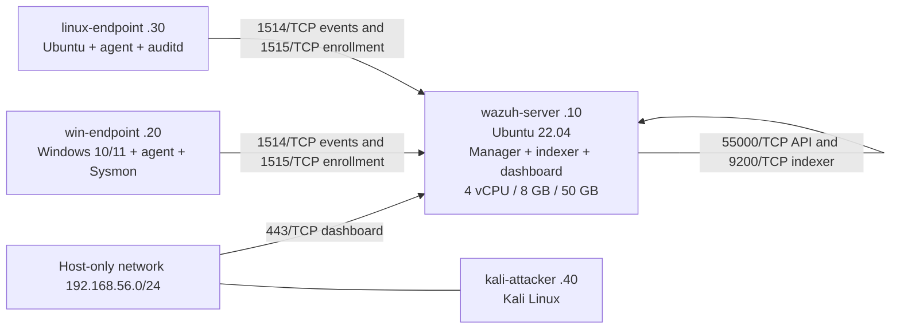

# Wazuh SIEM lab

An open-source Wazuh 4.x SIEM lab for collecting Windows and Ubuntu endpoint telemetry, testing detection rules, and rehearsing incident response. This repository is for controlled lab testing on an isolated host-only network. It is not a production deployment.



## Quick start

1. Create the four VMs and assign the [static addresses](docs/01-architecture.md).
2. Verify the current version at documentation.wazuh.com and [install the server](docs/02-server-install.md).
3. [Enroll both agents](docs/03-agent-enrollment.md) and [configure log collection](docs/04-log-collection.md).
4. [Load and test the detection rules](docs/05-detection-engineering.md), then [enable active response](docs/07-active-response.md).
5. [Run the lab exercises](docs/06-attack-simulation.md) and document findings with the [IR report template](ir-reports/TEMPLATE.md).

## Lab guide

- [Architecture](docs/01-architecture.md)
- [Server install](docs/02-server-install.md)
- [Agent enrollment](docs/03-agent-enrollment.md)
- [Log collection](docs/04-log-collection.md)
- [Detection engineering](docs/05-detection-engineering.md)
- [Attack simulation](docs/06-attack-simulation.md)
- [Active response](docs/07-active-response.md)
- [Ir playbook](docs/08-ir-playbook.md)
- [Metrics](docs/09-metrics.md)
- [Troubleshooting](docs/10-troubleshooting.md)

## Results

Record observed measurements in [Metrics](docs/09-metrics.md) and attach redacted captures under [screenshots](screenshots/).

## Repository checks

From the repository root on Ubuntu, install the `libxml2-utils` and `shellcheck` packages, then run:

```bash
xmllint --noout configs/{server,windows,linux}/*.xml
shellcheck scripts/*.sh
```
