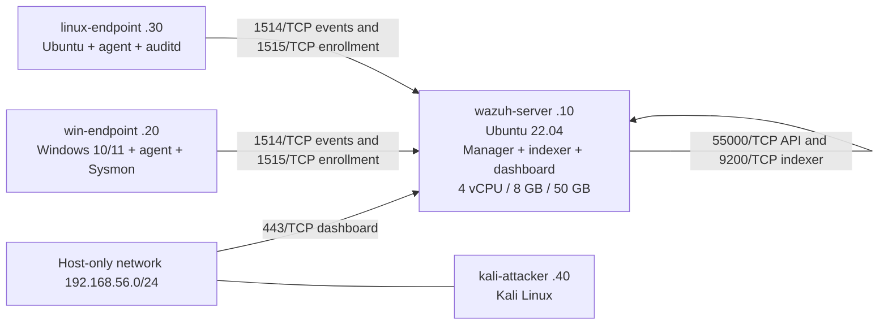

# Wazuh SIEM lab

An open-source Wazuh 4.x SIEM lab for collecting Windows and Ubuntu endpoint telemetry, testing detection rules, and rehearsing incident response. This repository is for controlled lab testing on an isolated host-only network. It is not a production deployment.



## Installation

1. Create the four lab VMs on the [host-only network](docs/01-architecture.md). Give the Ubuntu 22.04 server `192.168.56.10`, 4 vCPUs, 8 GiB RAM, and 50 GB of disk. Allow temporary package-download access during setup.
2. From the repository root on the server, run the all-in-one setup. Enter the 4.x series shown in the [Wazuh quickstart](https://documentation.wazuh.com/current/quickstart.html), such as `4.14`. Setup installs the manager, indexer, dashboard, and Filebeat and applies the lab rules.

   ```bash
   read -r -p 'Wazuh 4.x series: ' wazuh_series
   bash scripts/setup-lab-manager.sh "$wazuh_series"
   ```

3. [Enroll the Windows and Ubuntu agents](docs/03-agent-enrollment.md), then [configure log collection](docs/04-log-collection.md). Remove temporary package-download networking once setup is complete.
4. [Test the detection rules](docs/05-detection-engineering.md). Enable [active response](docs/07-active-response.md) after the rule tests pass.

## Dashboard

Open [the lab dashboard](https://192.168.56.10) from the lab host over HTTPS on TCP 443. Verify the TLS certificate against the server copy, then sign in as `admin` with the password generated by the installer. See the [server installation guide](docs/02-server-install.md#first-dashboard-login) for credential recovery and service checks.

| Check | Where to look | Expected result |
| --- | --- | --- |
| Agent enrollment | **Agents management → Summary** | `win-endpoint` and `linux-endpoint` are both **Active** after enrollment. |
| Alert ingestion | **Discover**, using `wazuh-alerts-*` | Alerts for the selected endpoint and exercise time range. For the synthetic SSH exercise, filter by `agent.name` = `linux-endpoint` and `rule.id` = `5763`. |
| File integrity | **Endpoint security → File Integrity Monitoring** | The path and event from the [FIM marker exercise](simulations/03-fim-file-drop.md). |

Use the [troubleshooting guide](docs/10-troubleshooting.md) if agents or alerts are missing. Record verified exercise results with the [incident report template](ir-reports/TEMPLATE.md).

## Lab guide

- [Architecture](docs/01-architecture.md)
- [Server install](docs/02-server-install.md)
- [Agent enrollment](docs/03-agent-enrollment.md)
- [Log collection](docs/04-log-collection.md)
- [Detection engineering](docs/05-detection-engineering.md)
- [Attack simulation](docs/06-attack-simulation.md)
- [Active response](docs/07-active-response.md)
- [Incident response playbook](docs/08-ir-playbook.md)
- [Metrics](docs/09-metrics.md)
- [Troubleshooting](docs/10-troubleshooting.md)

## Results

Record observed measurements in [Metrics](docs/09-metrics.md) and attach redacted captures under [screenshots](screenshots/).

## Repository checks

From the repository root on Ubuntu, install the `libxml2-utils` and `shellcheck` packages, then run:

```bash
xmllint --noout configs/{server,windows,linux}/*.xml
shellcheck scripts/*.sh
python3 scripts/test_lab_rules_unit.py
```

## License

Repository files are licensed under the [MIT License](LICENSE). Wazuh and other linked third-party projects retain their own licenses.
